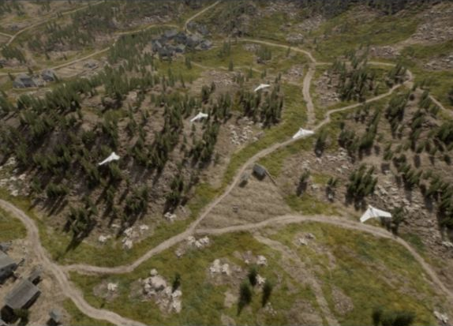

# JSBSim Physics

Project AirSim integrates JSBSim for fixed-wing and multirotor dynamics.

## Getting Started

JSBSim examples live under `client/python/example_user_scripts/jsbsim/` and are grouped by airframe:

| Path | Purpose |
| ---- | ------- |
| `cessna_310/` | Cessna 310 example script and sim configs |
| `x8_skywalker/` | Skywalker X8 scripts, tests, and sim configs |
| `rascal110/` | Rascal 110 fixed-wing example with PX4 SITL |
| `quadrotor-x/` | Auterion X-configuration quadrotor example with PX4 SITL |

### Prerequisites

1. Complete [Client Setup](../client_setup.md) (Python client installed, virtual environment activated).
2. Launch the Project AirSim simulation server.

## Cessna 310 example

Files:

| Path | Purpose |
| ---- | ------- |
| `cessna_310/hello_c310_jsbsim.py` | Connects, loads the scene, performs a short takeoff/turn/landing demo |
| `cessna_310/sim_config/scene_c310_jsbsim.jsonc` | Scene config for the C310 example |
| `cessna_310/sim_config/robot_c310_jsbsim.jsonc` | Robot config for the C310 example |

Run it from the repository root:

```bash
python client/python/example_user_scripts/jsbsim/cessna_310/hello_c310_jsbsim.py
```

## Skywalker X8 examples



Files:

| Path | Purpose |
| ---- | ------- |
| `x8_skywalker/hello_x8_jsbsim.py` | Loads the X8 scene, seeds an air launch, and flies a waypoint circuit |
| `x8_skywalker/x8_autopilot.py` | Reusable heading, altitude, airspeed, pitch, and roll controller |
| `x8_skywalker/run_x8_forest_swarm.py` | Runs the X8 swarm example in Forest/MountainVillage |
| `x8_skywalker/test_x8_autopilot.py` | Unit tests for the X8 autopilot helper |
| `x8_skywalker/sim_config/scene_x8_jsbsim.jsonc` | Paused steppable-clock scene for a single X8 |
| `x8_skywalker/sim_config/robot_x8_jsbsim.jsonc` | X8 JSBSim robot config |

Run the single-aircraft example:

```bash
python client/python/example_user_scripts/jsbsim/x8_skywalker/hello_x8_jsbsim.py
```

Optional longer run:

```bash
python client/python/example_user_scripts/jsbsim/x8_skywalker/hello_x8_jsbsim.py --max-sim-time 120
```

The swarm example generates its scene at runtime and reuses the same X8 robot config.

## Rascal 110 with PX4 SITL

The [Rascal 110 example](../../client/python/example_user_scripts/jsbsim/rascal110/)
uses the `Rascal110-JSBSim` flight model and `px4-api` controller.
The normal source build packages the model and its engine/system files under
`SimLibs/jsbsim/models/Rascal110-JSBSim`; keep that directory layout intact.

| Path under `rascal110/` | Purpose |
| ---- | ------- |
| `hello_rascal110_px4.py` | Loads the scene and holds the simulator connection for PX4 |
| `sim_config/scene_rascal110_px4_sitl.jsonc` | Rascal scene configuration |
| `sim_config/robot_rascal110_px4_sitl.jsonc` | JSBSim model paths, actuator mapping, and PX4 settings |
| `run_px4_rascal_takeoff.py` | Windows/WSL2 helper that starts PX4 and commands a takeoff |

Start the simulation server and a matching PX4 SITL instance using the
`rascal-electric` airframe, then load the scene from the repository root:

```bash
python client/python/example_user_scripts/jsbsim/rascal110/hello_rascal110_px4.py
```

The loader keeps the connection open; it does not command a takeoff. Use a
GCS or the supplied takeoff helper. Review the helper's `--help` and set its
`--distro`, `--px4-repo`, and `--windows-host` for your own WSL2 setup.
See [PX4 SITL setup](../controllers/px4/px4_sitl.md) for networking and connection settings.

## X-configuration quadrotor with PX4 SITL

The [quadrotor example](../../client/python/example_user_scripts/jsbsim/quadrotor-x/)
uses Auterion's `quadrotor_x` JSBSim model and a `px4-api` controller.
Its `sim_config/robot_quadrotor_x_jsbsim_px4_sitl.jsonc` defines the model paths,
PX4 connection, sensors, and actuator order; the matching scene is
`sim_config/scene_quadrotor_x_jsbsim_px4_sitl.jsonc`.

With the Unreal simulation server and a matching quadrotor PX4 SITL instance
running, execute from the repository root:

```bash
python client/python/example_user_scripts/jsbsim/quadrotor-x/hello_quadrotor_x_jsbsim.py
```

The script displays camera streams, arms, takes off, climbs, and lands.
Preserve the supplied actuator order when adapting the robot configuration.

## Without Unreal Engine and with multiple vehicles

[Project AirSim Runtime](../../samples/projectairsim_runtime/README.md) runs
JSBSim without Unreal Engine and supports multiple robots in one scene.
Give each robot a unique name and, for PX4 SITL, a separate autopilot instance
and connection settings; see [multi-vehicle PX4 setup](../controllers/px4/px4_multi_vehicle.md).
Runtime shares the simulation core and client APIs, but does not render camera,
LiDAR, or radar data or provide Unreal terrain geometry. Use a client workflow
without image displays instead of running the quadrotor camera demo unchanged.

Project AirSim also provides [ArduPilot SITL integration](../controllers/ardupilot.md).
The Rascal and quadrotor examples above use PX4; they do not demonstrate
ArduPilot with these JSBSim models.

## Ground Height Mode

JSBSim robots support two ground height modes through the robot config field
`jsbsim-ground-mode`:

```jsonc
{
  "physics-type": "jsbsim-physics",
  "jsbsim-ground-mode": "constant"
}
```

| Mode | Behavior |
| ---- | -------- |
| `constant` | Default. Uses the terrain/floor height at the initial robot position as one fixed ground height for the whole simulation. Falls back to the scene `home-geo-point.altitude` if no terrain sample is available. |
| `terrain` | Samples the Unreal terrain/floor height during the simulation. |

### Terrain Callback Usage

Project AirSim builds a terrain-elevation callback when JSBSim initializes. The
callback samples the robot's cached terrain elevation first, then the scene
terrain callback, and finally falls back to the scene `home-geo-point.altitude`.
That initial sample is used to set JSBSim's initial terrain elevation before
`RunIC()`.

After initialization, the callback installed into JSBSim depends on
`jsbsim-ground-mode`:

| Mode | JSBSim callback | Runtime usage |
| ---- | --------------- | ------------- |
| `constant` | `JSBSimConstantGroundCallback` | The Project AirSim terrain callback is sampled once at initialization. During the simulation, JSBSim receives the same fixed terrain elevation for every `GetAGLevel()` query. Unreal terrain is not queried again for JSBSim ground height. |
| `terrain` | `JSBSimTerrainGroundCallback` | JSBSim calls back during `GetAGLevel()` queries. The callback converts JSBSim latitude/longitude to Project AirSim NED coordinates, samples the scene terrain elevation at that location, and updates JSBSim's terrain elevation before JSBSim computes AGL/contact data. If the sample is invalid, the last valid value is reused, then the home altitude fallback is used. |

These callbacks feed JSBSim's internal ground-height calculations, including
height-above-ground and contact-related state. Project AirSim's own collision
response path, such as `NeedsCollisionResponse()` and
`CalcNextKinematicsWithCollision()`, is separate from the JSBSim terrain
callback.

## Timestep

JSBSim robots support a configurable internal physics timestep through the
robot config field `jsbsim-dt`, in seconds:

```jsonc
{
  "physics-type": "jsbsim-physics",
  "jsbsim-model": "c310",
  "jsbsim-dt": 0.008333333333333333
}
```

If `jsbsim-dt` is omitted, Project AirSim uses `1/120` s
(`0.008333333333333333`, or 120 Hz).

## Known Issues

1. **Flat ground surface (no mesh following)**
   - In `constant` ground mode, the simulated ground is flat at the terrain/floor height sampled at the initial robot position. Different parts of the vehicle cannot rest at different heights on sloped terrain. There is no mesh-following behavior after initialization.
   - In `terrain` ground mode, JSBSim samples terrain height at several contact points and has the capacity to respond to irregular ground surfaces.

2. **Ground penetration during sustained ground movement**
   - If a JSBSim vehicle continuously advances on the ground, it slowly sinks over time until it fully penetrates the terrain surface.

## Reference

Berndt, J. S., Coconnier, B., De Marco, A., & McLeod, S. (2026).
*JSBSim, An Open Source Flight Dynamics Software Library*.
Journal of Open Source Software, 11(126), 11129.
[https://doi.org/10.21105/joss.11129](https://doi.org/10.21105/joss.11129).

---

Copyright (C) IAMAI CONSULTING CORP

MIT License. All rights reserved.
