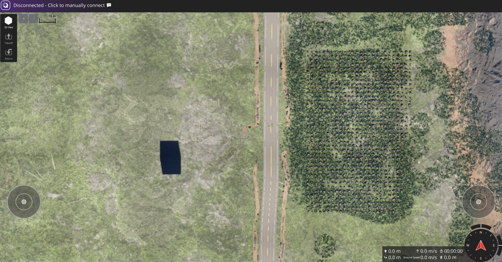

# Tile Camera and HTTP Tile Server Actors

This page explains how to use the tile actors added to the `ProjectAirSim` Unreal plugin:

- `ATileCameraActor` - maps XYZ tile coordinates to a camera world position and sets orthographic width.
- `ATileHttpServerActor` - serves tile PNG files over HTTP from disk and can render missing tiles on demand through `ATileCameraActor`.
- `UTileMercatorLibrary` - helper library used by both actors to convert tile coordinates to Unreal world coordinates.

The source files are located in:

- `unreal/Blocks/Plugins/ProjectAirSim/Source/ProjectAirSim/Private/Tiles/TileCameraActor.*`
- `unreal/Blocks/Plugins/ProjectAirSim/Source/ProjectAirSim/Private/Tiles/TileHttpServerActor.*`
- `unreal/Blocks/Plugins/ProjectAirSim/Source/ProjectAirSim/Private/Tiles/TileMercatorLibrary.*`



## Prerequisites

1. Use a build that includes the tile actor commit.
2. Ensure the plugin compiles with `HTTPServer` enabled in module dependencies.
3. Open your Unreal level and place the actors from the ProjectAirSim plugin classes.

## How to use `ATileCameraActor`

`ATileCameraActor` is responsible for computing camera transform and ortho width for one map tile.

1. Place a `TileCameraActor` in the level.
2. Configure these key properties in Details panel:
   - `Zoom`, `TileX`, `TileY`
   - `OriginLat`, `OriginLon` - latitude/longitude of the Unreal world origin. Use the same values as `home-geo-point` in your scene config (`.jsonc`), otherwise the map will be shifted relative to the simulated GPS position.
   - `AltitudeMeters` - camera height above the world origin. It must be above all geometry you want on the map.
   - `bTileYIsTMS` if your Y index uses TMS format
3. Enable `bUpdateOnBeginPlay` for one-time initialization or `bUpdateEveryTick` for continuous updates.
4. If you need immediate capture output, enable `bCaptureAfterUpdate`.

Notes:

- The actor uses a `SceneCaptureComponent2D` with orthographic projection. The camera always looks straight down with north at the top of the image, regardless of how the actor is rotated in the level.
- `bNorthIsX` controls the world axis convention:
  - `true` (default): X=North, Y=East. This is the ProjectAirSim convention (NED mapped to Unreal).
  - `false`: X=East, Y=South (Cesium for Unreal convention).
- `bUseMercatorScale`:
  - `false` (default): tiles are placed with the same projection ProjectAirSim uses to compute GPS (`EarthUtils::NedToGeodetic`), so map pixels match the simulated latitude/longitude at every zoom level.
  - `true`: raw Web Mercator meters are used as Unreal meters. Only use this if the level itself was built in Web Mercator units; otherwise the map is scaled by `1/cos(latitude)` (about 1.48x at 47.6°N).

### Exposure

Scene captures do not run auto exposure the way the game viewport does, so tiles would otherwise come out dark, and the brightness would change from one tile to the next. By default the actor:

1. Measures the scene once, before the first tile is rendered, over `ExposureCalibrationWidthMeters` (default 400 m) around the world origin.
2. Locks that exposure (`CalibratedExposureBias`) for every tile, so neighbouring tiles always match.

Related properties (category `Tiles|Exposure`):

- `bUseManualExposure` (default `true`) - use one fixed exposure for all tiles.
- `bAutoCalibrateExposure` (default `true`) - measure the exposure automatically as described above.
- `ExposureBias` - extra compensation in EV on top of the calibration (`+1` doubles brightness, `-1` halves it).
- `CalibrateExposure()` - Blueprint-callable; call it again after changing lighting or time of day.

Vignette, motion blur and temporal anti-aliasing are disabled for tile captures.

## How to use `ATileHttpServerActor`

`ATileHttpServerActor` exposes tiles over HTTP with route:

- `GET /tiles/:z/:x/:y`

### Basic file-server mode (cache only)

1. Place a `TileHttpServerActor` in the level.
2. Set:
   - `Port` (default `8080`)
   - `RoutePrefix` (default `/tiles`)
   - `TileRootDir` (default `Saved/Tiles` when relative)
   - `MinZoom`, `MaxZoom`
3. Keep `bRenderMissingTiles = false`.
4. Start play. Existing files at `TileRootDir/z/x/y.png` are served directly.

### On-demand render mode (render missing tiles)

1. Place both `TileCameraActor` and `TileHttpServerActor` in the level.
2. In `TileHttpServerActor`, set:
   - `bRenderMissingTiles = true`
   - `TileCamera = <your TileCameraActor instance>`
3. Optionally set `TileSize` (default `256`) and `bTileYIsTMS`.
4. When a tile is missing on disk, the server renders it, returns PNG bytes, and saves to cache.

Rendered tiles are cached on disk and served from the cache on later requests. After changing camera, exposure or level settings, delete the cache folder (default `<ProjectSavedDir>/Tiles`) or set `bServeCachedTiles = false`, which re-renders every request and overwrites the cached PNG. Invalid requests (non-numeric or out-of-range `z/x/y`) return an error instead of a tile.

## Using the tiles in QGroundControl

1. Set `OriginLat`/`OriginLon` on the `TileCameraActor` to the scene's `home-geo-point`.
2. Start play with the server in on-demand render mode.
3. In QGroundControl, add a custom map provider with the URL `http://127.0.0.1:<Port>/tiles/{z}/{x}/{y}.png` and select it as the map.

## Request examples

With default settings (`Port=8080`, `RoutePrefix=/tiles`):

```bash
curl -o tile.png http://127.0.0.1:8080/tiles/20/0/0
```

PNG extension in URL is also accepted:

```bash
curl -o tile.png http://127.0.0.1:8080/tiles/20/0/0.png
```

## Tile directory layout

Rendered or pre-generated tiles are expected/saved as:

```text
<TileRootDir>/<z>/<x>/<y>.png
```

If `TileRootDir` is relative (for example, `Tiles`), absolute location becomes:

```text
<ProjectSavedDir>/Tiles
```
